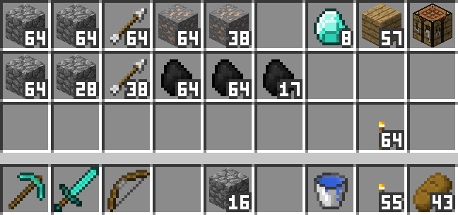
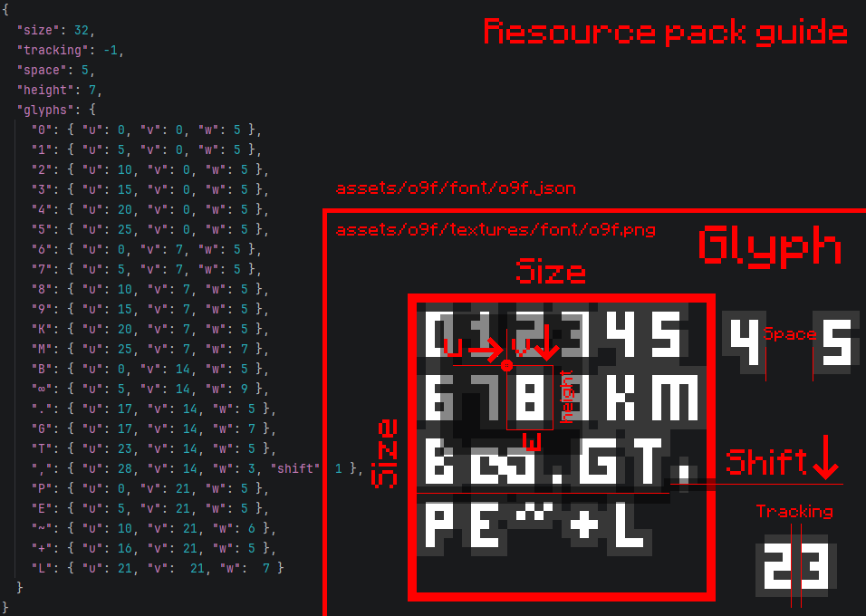

# o9f

Backport of mod ["o123456789f" by Gvoper](https://modrinth.com/mod/o123456789f) (and originally ["o123456789" by catboybinary](https://modrinth.com/mod/o123456789)) for Minecraft 1.7.10.

Mod adds fancy font for your items counts and fully client-side.

## Custom font

Just create resource pack by next guide:

Yes, you can use bigger image for more space for glyphs!

## Planned things

- NEI (GTNH) support (disable dynamic font for now)
- Applied Energetics GUIs
- Extra Cells monitors and with implementation counts in GUIs.
- Thaumcraft aspect/essentia/vis counts.
- JABBA barrels counts.

You can ask for some mod support (if its now working out of the box) by GitHub issues

## Build

Build requirements:
- JDK 8 as default Java (for Gradle run).
- JDK 16 in Gradle JDKs list for use in tasks (can be specified by `gradle.properties` with `org.gradle.java.installations.paths` key.

Clone repository and run `gradlew build`.
